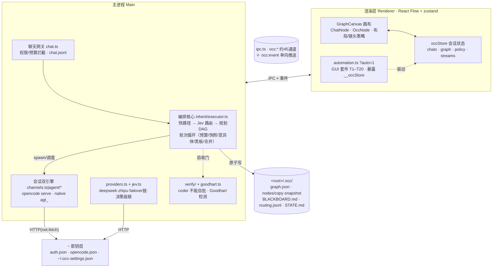
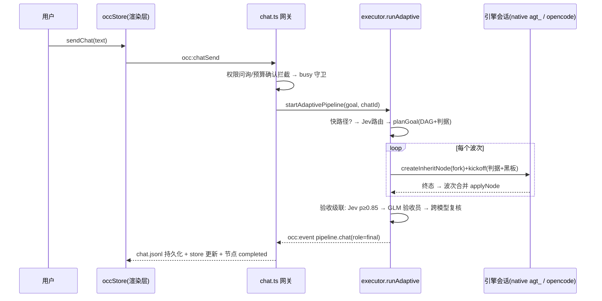
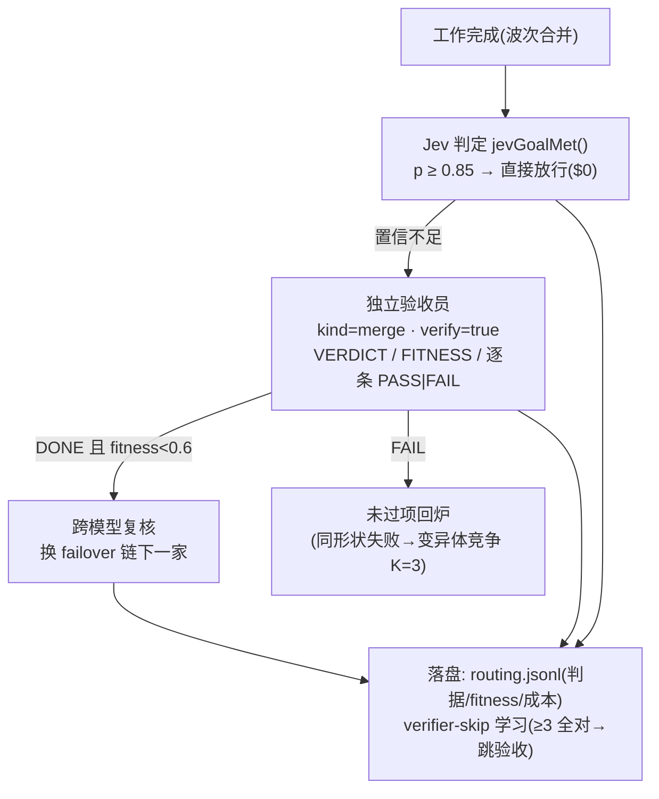
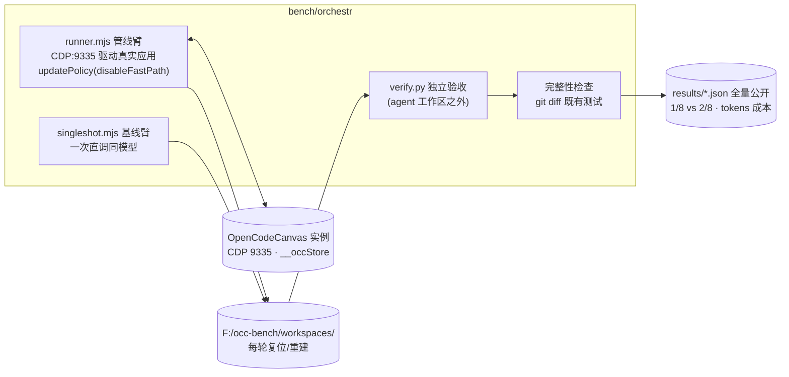

# 架构图解 (ARCHITECTURE)

> 配套图：[`architecture.svg`](./architecture.svg)。以下用 mermaid 画四张图：分层总览、一次对话的时序、验收级联、评测回路。所有名称均来自真实代码（2026-10 版）。

## 1. 分层总览

要点：`ipc.ts` 是唯一 IPC 面；`events.ts` 的 `occ:event` 是全局事件主干（共用同一份数据流给 UI、聊天日志与路由学习）；每项目一份 `.occ/` 是唯一事实源（graph.json 追加写 + 原子落盘，能带着图谱续作重启）。

## 2. 一次对话的时序

## 3. 验收级联（便宜的检查先跑）

设计动机：coder 不能自批（`verifiedApply` 强制走外部测试+审查），Goodhart 检测防刷分；无篡改史累积若干次后才允许跳过验收（`skipVerifier`），省钱但可回退。

## 4. 评测回路（orch-bench）

评测纪律：判据先于运行定义；bugfix 任务采用 SWE-bench 式「修复前源码 + 金补丁测试」筛选 FAIL_TO_PASS（10 个候选只留 1 个可度量的，其余诚实剔除并记录原因）。
